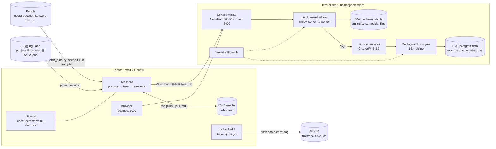

# Architecture (U1)

All MLflow state lives on two PVCs in the `kind` cluster, so deleting either pod loses nothing.
The laptop, the browser and (in U2) an in-cluster training Job all reach the same `mlflow` Service.

## Lineage

| Dimension | Owner | Link in each MLflow run |
| --- | --- | --- |
| Code | Git | tag `git_commit` |
| Data bytes | DVC (`data/raw/dataset.parquet.dvc`, `dvc.lock`) | tag `dvc_raw_md5`, dataset digest via `log_input` |
| Configuration | `params.yaml` | run params (incl. model name, revision, seed) |
| Environment | `requirements*.txt`, training image | LoggedModel `requirements.txt`; image tag `sha-<commit>` |
| Model | MLflow LoggedModel on PVC | `model_id`, `models/run_id.txt` in Git |
